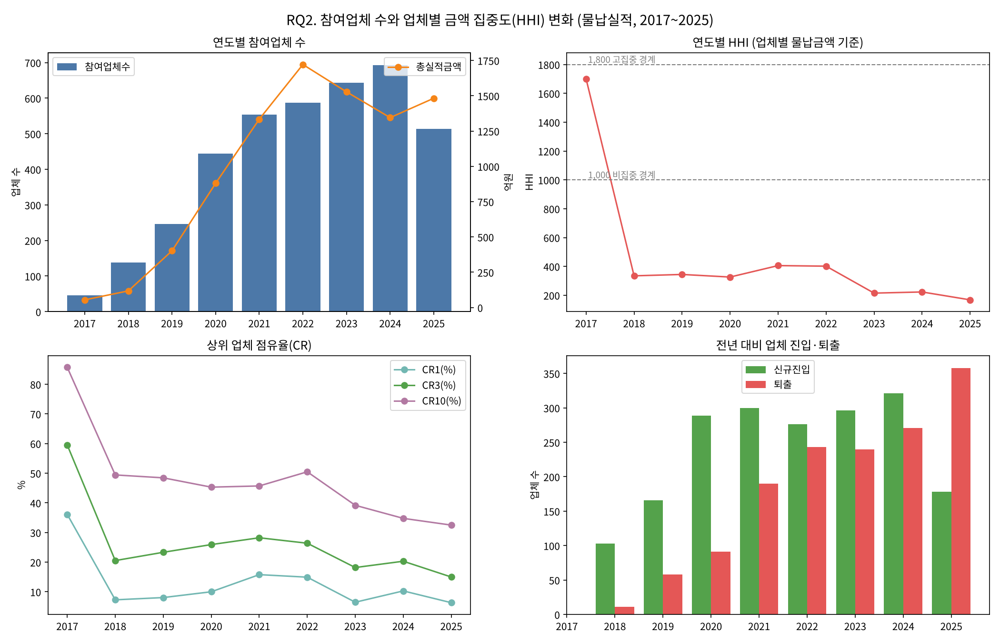
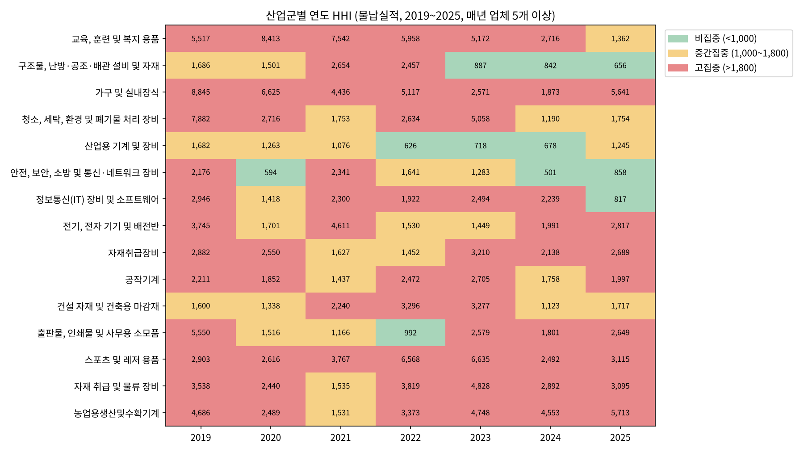

# 벤처나라 공공조달 시장의 참여업체 수와 금액 집중도(HHI) 분석

조달청 벤처나라 9년치 거래실적으로 "시장이 커진 만큼 기회도 넓게 퍼졌는가"를 검증한 5인 팀 프로젝트 중, **데이터 전처리와 RQ2(참여업체 수·금액 집중도) 분석**을 정리한 저장소입니다.

| 핵심 결과 | |
|---|---|
| **약 15배** | 물납 기준 참여업체 2017년 46개 → 2024년 693개 (2025년 513개로 처음 감소) |
| **HHI 168** | 2025년, 9년 중 최저. 2018년 이후 매년 1,000 미만(비집중) |
| **15개 중 12개** | 산업군 단위로 보면 2025년 HHI 1,000 이상. 산업 안은 여전히 집중 |



---

## 1. 프로젝트 개요

| 항목 | 내용 |
|---|---|
| 형태 | 데이터 분석 팀 프로젝트 (5인), 2026.10 |
| 데이터 | 조달청 벤처나라 통합실적 52,582행 × 43열 (2016.10~2026.10) + 물품분류번호 식별자 |
| 도구 | Python (pandas, numpy, scipy, matplotlib) |
| 내 역할 | 데이터 전처리, RQ2 분석·시각화 |

### 문제정의

| 비즈니스 질문 | 연구문제 | 담당 |
|---|---|---|
| 벤처나라는 잘 운영되고 있나? | RQ1. 거래기록과 실적금액은 언제 증가했는가? | 팀원 |
| 기회는 업체에게 균등하게 분배되는가? | **RQ2. 참여업체 수와 업체별 금액 집중도(HHI)는 어떻게 달라졌는가?** | **본인** |
| (운영·기회 세분화) | RQ3. 주문/물납 및 품목군별로 결과가 달라지는가? | 팀원 |
| 미래 수요를 예측할 수 있나? | RQ4. 과거 이력으로 2026년의 희소한 구매 발생을 판별할 수 있는가? | 팀원 |

이 저장소에는 본인이 담당한 전처리와 RQ2만 포함되어 있습니다.

---

## 2. 데이터 전처리

원본 52,582행 × 43열을 8단계로 정리해 52,210행 × 23열의 단일 CSV를 만들었습니다. → [`notebooks/01_preprocessing.ipynb`](notebooks/01_preprocessing.ipynb)

| 단계 | 처리 | 결과 |
|---|---|---|
| 1 | 수량·단가 보정 (실적금액 = 수량 × 단가 기준으로 뒤바뀐 값 교환) | 90행 |
| 2 | 업체명 정제 (`주식회사`·`(주)`·영문 괄호 제거) | 2,278 → 2,263개 |
| 3 | 실적금액 0원 행 삭제 | 372행 |
| 4 | 불필요 열 삭제 | 43 → 23열 |
| 5~7 | 날짜 변환, 업체번호 정수화, 범주형 Label Encoding | |
| 8 | 완전 중복 행 제거 | 0행 |

업체 집계는 업체명이 아니라 `벤처업체번호`로 했습니다. 업체명을 정제하면 이름 하나에 번호가 여러 개 붙는 경우가 생기기 때문입니다.

---

## 3. RQ2 분석

→ [`notebooks/02_rq2_concentration.ipynb`](notebooks/02_rq2_concentration.ipynb), 함수: [`src/concentration.py`](src/concentration.py)

### 3-1. 분석 기준 결정

모집단이 바뀌면 HHI도 바뀌기 때문에, 분석 전에 기준부터 고정했습니다.

| 결정 | 근거 |
|---|---|
| 기간: 2017~2025년 | 2016년(10월~)·2026년(~10월)은 부분 연도라 연간 비교를 왜곡 |
| 실적: 물납(코드 3)만 | 주문(코드 2)은 3~4년치를 한 번에 발주할 수 있어 연도별 배분이 왜곡됨. 물납은 실제 납품 시점 실적 |
| 업체 식별: 벤처업체번호 | 같은 번호에 업체명 표기가 2개 이상인 경우가 14개 (2017~2025년) |

분석 대상: 52,210행 → 47,170행(2017~2025) → **30,172행(물납)**

### 3-2. 지표

```
HHI = Σ (업체별 금액 점유율 %)²     # 0(완전 분산) ~ 10,000(1개 업체 독점)
```

| 지표 | 정의 |
|---|---|
| HHI | 점유율 제곱의 합. 등급은 미국 DOJ/FTC 3단계 참고 (비집중 < 1,000 / 중간 1,000~1,800 / 고집중 > 1,800) |
| CR1·CR3·CR10 | 상위 1·3·10개 업체 점유율 합 |
| 유효업체수 | 10,000 ÷ HHI. 몇 개 업체가 균등하게 나눈 것과 같은가 |
| 업체당 평균 vs 중앙값 | 소수 대형 업체가 평균을 끌어올리는지 |
| 신규진입·퇴출 | 전년 대비 업체 집합 차이 |

### 3-3. 연도별 결과

| 연도 | 2017 | 2018 | 2019 | 2020 | 2021 | 2022 | 2023 | 2024 | 2025 |
|---|---|---|---|---|---|---|---|---|---|
| 참여업체(개) | 46 | 138 | 246 | 444 | 554 | 587 | 643 | 693 | 513 |
| HHI | 1,701 | 334 | 344 | 326 | 405 | 402 | 215 | 223 | 168 |
| CR10(%) | 85.7 | 49.4 | 48.4 | 45.3 | 45.7 | 50.5 | 39.2 | 34.8 | 32.5 |

- 2018년 HHI가 334로 급락한 뒤 170~400 사이를 유지했고, 2025년 168로 최저였습니다.
- 2025년 업체 감소(693 → 513개)는 퇴출 358개가 신규 178개를 넘은 결과입니다. 빠진 업체의 2024년 금액 중앙값은 0.16억 원으로, 남은 업체(0.76억 원)보다 훨씬 작았습니다. 다만 빠진 업체 전체로는 2024년 금액의 30%를 차지했습니다.
- 주문·전체 기준으로도 2025년 HHI는 134(전체) / 141(주문) / 168(물납)로 같은 방향입니다.

### 3-4. 추세검정과 민감도 분석

HHI는 1년에 값이 하나라 검정 표본이 9개뿐입니다. Spearman 상관과 선형회귀를 함께 쓰고, 튀는 해인 2017년을 뺀 결과와 비교했습니다.

| 지표 | 2017~2025 | 2018~2025 (2017 제외) |
|---|---|---|
| 참여업체 수 | 유의한 증가 (ρ 0.83, 연 +74.5개) | 유의한 증가 (ρ 0.76) |
| HHI | 감소 경향 (ρ -0.72) | 뚜렷한 추세 없음 (p 0.12) |
| CR3 | 감소 경향 (ρ -0.67) | 뚜렷한 추세 없음 (p 0.18) |
| 유효업체수 | 유의한 증가 (ρ 0.72) | 증가 경향 |

업체 수 증가는 어떤 기준으로도 확실했지만, 집중도 감소는 2017→2018년 급락에 기대고 있었습니다. 그래서 "계속 낮아졌다"가 아니라 **"초기 집중 → 2018년 급격한 분산 → 이후 저집중 유지"**로 해석했습니다. 업체 수와 HHI의 직접 관계는 유의하지 않아(p 0.22) 인과 해석은 하지 않았습니다.

### 3-5. 산업군별 분석

전체 HHI는 서로 경쟁하지 않는 산업을 한 시장으로 합쳐 낮게 나오는 효과가 있어, 42개 산업군별로 다시 계산했습니다. 업체가 적으면 HHI가 과대 계산되므로 2019~2025년 매년 업체 5개 이상인 15개 산업군만 비교했습니다.



- 지속적으로 분산된 산업은 **교육·복지용품**(5,517 → 1,362, 유의한 감소)과 **구조물·공조 설비**(1,686 → 656, 금액 1위 산업) 2개뿐입니다.
- 나머지 13개는 대형 계약 몇 건에 HHI가 수천씩 출렁였고, 2025년 기준 15개 중 12개가 HHI 1,000 이상입니다.
- 매년 업체 0~3개인 13개 산업군(금액 0.5%)은 제외하고, 같은 업체가 반복 납품하는지 따로 확인했습니다.

---

## 4. AI 분석 결과 검증 — 내가 바로잡은 것

분석은 AI(Claude)와 함께 진행했습니다. AI는 코드와 수치를 빠르게 만들어 냈지만, 그대로 쓰면 기준이 모호하거나 결론이 과장된 분석이 섞여 있었습니다. 결과마다 "왜 이 기준인가", "이 결론이 특정 값에 기대고 있지 않은가"를 물어 아래 항목을 바로잡았습니다.

| AI 초안 | 내가 던진 질문·판단 | 바로잡은 결과 |
|---|---|---|
| 2016~2026년 전체를 연도별로 비교 | 부분 연도를 연간 값과 나란히 두면 안 된다 | 2017~2025년으로 고정 |
| 주문+물납 합산 유지 권고 | 주문은 3~4년치를 한 번에 발주할 수 있다는 업무 특성 반영 | 물납 기준으로 모집단 고정 |
| 전반기 vs 후반기 평균 비교 | 구간을 나눌 근거가 무엇인가? | 근거 없음 확인 후 삭제 |
| 추세검정 p값만 나열 | p값만으로는 결론 판단이 어렵다 | 결론 열 추가, 2017 제외 민감도와 비교해 해석 수정 |
| 산업군 HHI 2019 vs 2025 두 해 비교 ("16개 중 13개 분산") | 두 해만 비교하는 게 맞나? | 연도별 추세로 다시 보니 지속 분산은 2개 → 과장된 결론 철회 |
| "매년 업체 0~3개 산업군 약 15개" | 매년 같은 업체인가? | 코드로 확인해 13개로 정정 |
| HHI 등급과 다른 연속 색 히트맵 | 표의 기준과 그림이 비교되지 않는다 | 등급 3단계 색, 표와 같은 대상으로 통일 |

AI가 분석을 실행하는 환경에서도 분석 기준을 정하고 결론을 검증하는 것은 사람의 몫이라는 점을 확인했습니다.

---

## 5. 한계

- 금액은 기록상 실적이며 검증된 순매출이 아닙니다.
- HHI는 플랫폼 기록상 집중도로, 법적 경쟁시장 평가나 공정성의 직접 증거가 아닙니다.
- 연도별 값 9개로 검정해 p값이 불안정할 수 있습니다.

---

## 6. 실행 방법

```bash
pip install -r requirements.txt
```

1. 원본 데이터를 `data/raw/`에 넣습니다 ([`data/README.md`](data/README.md) 참고).
2. `notebooks/01_preprocessing.ipynb` → `notebooks/02_rq2_concentration.ipynb` 순서로 실행합니다.
3. 그래프는 `figures/python/`, 결과 표는 `results/`에 저장됩니다.

## 폴더 구조

```
├── data/              # 데이터 안내 (원본 CSV는 포함하지 않음)
├── notebooks/         # 01 전처리, 02 RQ2 분석
├── src/               # HHI·CR 계산, 추세검정 함수
├── figures/python/    # 분석 그래프
└── results/           # 분석 결과 표 (CSV)
```
